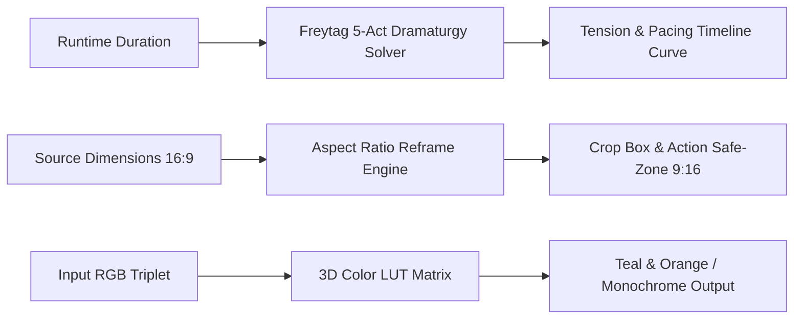

# genpark-creative-agent


GenPark Creative Agent has a standard-library core for storytelling, cinematography, and post-production engine implementing Freytag's Pyramid dramatic tension trajectory modeling, multi-aspect ratio crop and safe-zone reframe geometry (9:16, 1:1, 16:9, 4:5), and 3D LUT cinematic color grading matrix transformations.



## MCP runtime requirements

Use Python 3.10 or newer. The core `client.py` uses only the standard library; `mcp_server.py` requires the official `mcp` SDK (`mcp>=1.0.0,<2`). From this repository's checkout, create an isolated environment and install its requirements:

```bash
python -m venv .venv
.venv/bin/python -m pip install -r requirements.txt
```

On Windows, use `.venv\Scripts\python.exe` instead. You may use an existing Python environment with the requirements installed. Configure your MCP client with that interpreter's absolute path and the absolute path to `mcp_server.py`. The client launches a local STDIO process; the GitHub repository URL is not a remote MCP endpoint.

Example client configuration (replace the placeholder paths):

```json
{
  "mcpServers": {
    "genpark-creative-agent": {
      "command": "/absolute/path/to/genpark-creative-agent/.venv/bin/python",
      "args": [
        "/absolute/path/to/genpark-creative-agent/mcp_server.py"
      ]
    }
  }
}
```

## Features
- **Freytag's Pyramid Dramaturgy**: Generates smooth narrative tension curves and identifies climax timing across arbitrary runtimes.
- **Cross-Platform Reframe**: Converts between landscape, square, and vertical video with UI safe-zone margin calculations.
- **Cinematic LUT Transforms**: Simulates teal-and-orange split-toning and high-contrast monochrome color grading.

## Quickstart

```python
from client import GenParkCreativeAgent

agent = GenParkCreativeAgent()
res = agent.calculate_aspect_ratio_reframe_matrix(1920, 1080, "9:16")
print("Crop Box:", res["crop_box"])
```

## License
MIT
