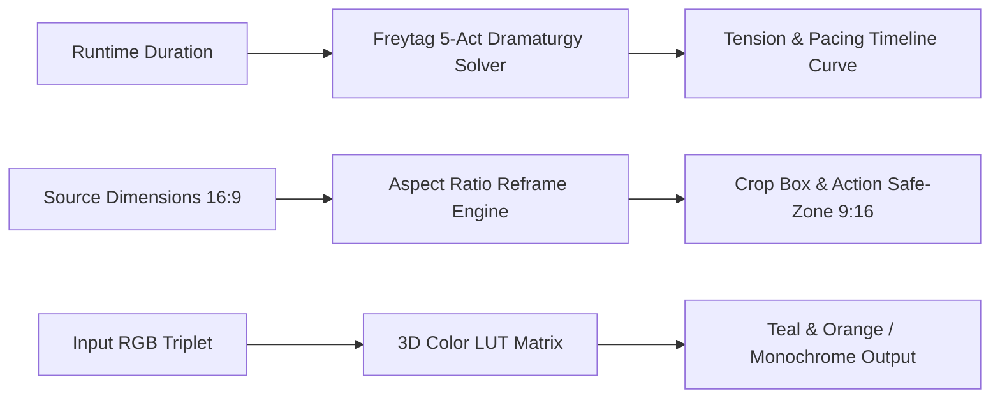

# genpark-creative-agent


GenPark Creative Agent is a zero-dependency storytelling, cinematography, and post-production engine implementing Freytag's Pyramid dramatic tension trajectory modeling, multi-aspect ratio crop and safe-zone reframe geometry (9:16, 1:1, 16:9, 4:5), and 3D LUT cinematic color grading matrix transformations.



## Features
- **Freytag's Pyramid Dramaturgy**: Generates smooth narrative tension curves and identifies climax timing across arbitrary runtimes.
- **Cross-Platform Reframe**: Converts between landscape, square, and vertical video with UI safe-zone margin calculations.
- **Cinematic LUT Transforms**: Simulates teal-and-orange split-toning and high-contrast monochrome color grading.

## Quickstart

```python
from client import GenParkCreativeAgent

agent = GenParkCreativeAgent()
res = agent.calculate_aspect_ratio_reframe_matrix(1920, 1080, "9:16")
print("Crop Box:", res["crop_box"])
```

## License
MIT
